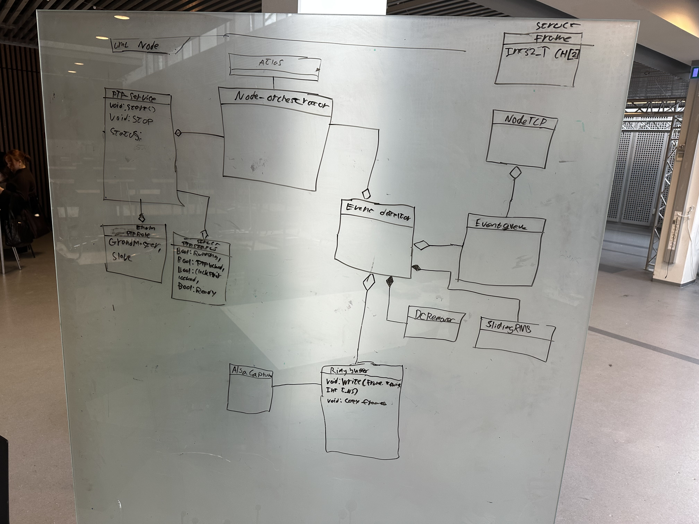

# tegnet_udkast_softwarearkitekttur_node.jpeg

> Genereret fil. Ret originalen, ikke denne kopi.

- Kilde: [construction/tegnet_udkast_softwarearkitekttur_node.jpeg](../construction/tegnet_udkast_softwarearkitekttur_node.jpeg)
- SHA-256: `32551c230c6120f8fa2f7e973916585c60ccfd3c52d0e6a51fd2e0408643bf07`
- Status: billede med OCR

> OCR markerer 67 af 95 ord som usikre; sammenhold dem med den viste illustration.
> OCR gengiver tekst, ikke pile, geometri eller relationer. Brug den viste illustration til visuel information.

---



## Billedtekst (OCR)

```text
eg:
rr
re
———
ae a
SCeUC
ot
Drrs2
CH[2
3
AC lef
—
L
—
7
2
si
|
_
de- che re_|
- ees ss ee 1
D
=
Oe ey
}
ro Mh OO MS
<
NodeICP
eee
fe
ae
DEN
FH
amme.
fars
K
H H sees
=
~
\
E
Vv.
i}
oe
|
VY
”
I
i
||
||
a
oe
it
Ae
Si
a;
RM
SR
J
<<<.
&
AN
:
Rtu
in ute HEE
~
vod Write (Prose, 7
Tne Cys)
Void. Cory Cyomeg |
ory
ea
```
